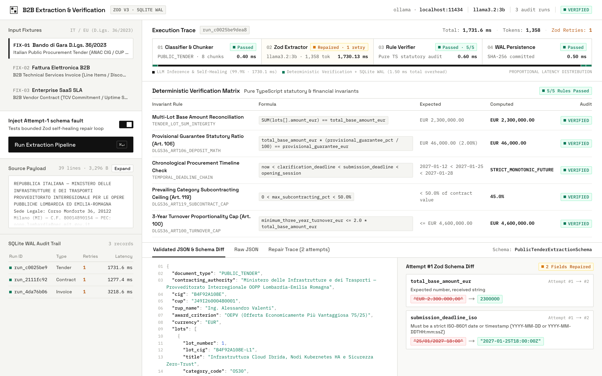

# Deterministic B2B Document Extraction & Verification Pipeline

A full-stack TypeScript / Next.js (App Router) engineering platform that ingests unstructured B2B documents (Italian Public Procurement Tenders under `D.Lgs. 36/2023`, `FatturaPA TD01` Electronic Invoices, and Enterprise `SaaS MSA/SLA` Contracts) and executes a 4-stage deterministic extraction, self-healing `Zod` validation, and pure-TypeScript mathematical verification pipeline backed by SQLite WAL audit persistence.



---

## Core Engineering Architecture

1. **OpenAI-Compatible Local & Cloud Provider Abstraction (`src/lib/llm.ts`):**
   Connects directly to local self-hosted inference servers (**Ollama** `http://localhost:11434/v1`, **LM Studio** `http://localhost:1234/v1`, **vLLM**) or cloud endpoints via `LLM_BASE_URL` and `LLM_MODEL`. Automatically probes `/v1/models` and selects `qwen2.5:14b` if available or falls back to installed local models (such as `llama3.2:3b`) so the pipeline runs out of the box on local hardware.
2. **Stage 1 — Document Classifier & Structural Chunker (`src/lib/pipeline/classifier.ts`):**
   Computes a cryptographic `SHA-256` document fingerprint, segments structural blocks, estimates token footprint, and classifies documents into `PUBLIC_TENDER`, `B2B_INVOICE`, or `VENDOR_CONTRACT`.
3. **Stage 2 — Self-Healing `Zod` Validation Loop (`src/lib/pipeline/extractor.ts`):**
   Enforces strict domain schemas (`ANAC CIG/CUP`, `ISO-13616 IBAN`, `EU VAT`, `ISO-8601` timestamps, numeric bounds). When an extraction attempt fails `schema.safeParse()`, the pipeline traverses the nested candidate AST via `getValueAtPath()` to capture the exact `ZodIssue` path and received value, injects the prior candidate JSON and structured diff back into the repair prompt (up to 3 retries), and halts with `MANUAL_REVIEW_REQUIRED` if convergence fails.
4. **Stage 3 — Pure-TypeScript Deterministic Business-Rule Engine (`src/lib/pipeline/verifier.ts`):**
   Cross-checks extracted financial and regulatory invariants independently of the LLM:
   - **Public Tenders (`D.Lgs. 36/2023`):** Multi-lot sum reconciliation, Art. 106 `2.0%` provisional bond math, chronological deadline chain, Art. 119 subcontracting cap (`< 50%`), and Art. 100 turnover proportionality (`<= 2.0x`).
   - **B2B Invoices (`FatturaPA TD01`):** Line-item quantity $\times$ unit price $\times$ discount extensions, net taxable base (`Imponibile`) sum, `22%` VAT calculation, gross payable total, and 27-char Italian SEPA IBAN verification.
   - **Enterprise Contracts (`MSA & SLA`):** Multi-year TCV commitment math, aggregate liability super-cap multiplier (`2.0x`), monotonic SLA service credit tiers, and `GDPR Art. 33` breach notification ceiling (`<= 72h`).
5. **Stage 4 — SQLite WAL Audit Persistence (`src/lib/pipeline/db.ts`):**
   Persists every execution trace, step latency, token count, retry diff, and rule verification matrix to `./data/pipeline-audit.sqlite` in `WAL` mode.

---

## Quickstart

### 1. Install Dependencies & Configure Environment

```bash
cp .env.example .env
npm install
```

### 2. Run Automated Pipeline & Verification Tests

```bash
npm test
```

### 3. Build & Run Production Server

```bash
npm run build
npm run start
```

Open `http://localhost:3000` in your browser to access the Engineering Observability Dashboard.

---

## Pipeline Execution Metrics (Live Local Ollama Benchmark)

Measured on **Apple M3 (8 cores, 24.0 GB RAM, `darwin/arm64`)** running full-document JSON extraction (`temperature: 0`, `max_tokens: 2048`, `response_format: { type: "json_object" }`) against live local **Ollama (`http://localhost:11434/v1`, model `llama3.2:3b`)** with SQLite WAL audit persistence:

### Stage-by-Stage Telemetry (`FIX-01`: `PUBLIC_TENDER` with 2-Attempt Self-Healing Repair)

| Stage | Component | Status | Latency (`ms`) | Tokens | Execution Summary |
| :--- | :--- | :--- | :--- | :--- | :--- |
| **01** | `Classifier & Chunker` | **Passed** | `1.12 ms` | `0` | `Type=PUBLIC_TENDER` (`99.8%` conf), `8` structural chunks, SHA-256 `49f8a901ce35b1d6` |
| **02** | `Zod Extractor` | **Repaired · 1 retry** | `56,541.27 ms` | `5,843` | Caught Attempt #1 schema faults (`total_base_amount_eur`, `submission_deadline_iso`); self-healed on Attempt #2 via `llama3.2:3b` |
| **03** | `Rule Verifier` | **Passed · 5/5** | `24.44 ms` | `0` | `5/5` pure-TypeScript mathematical & statutory invariants verified |
| **04** | `WAL Persistence` | **Passed** | `27.35 ms` | `0` | Committed immutable audit record to `./data/pipeline-audit.sqlite` |
| **Total** | **End-to-End Pipeline** | **VERIFIED** | **`56,594.18 ms`** | **`5,843`** | **1 Self-Healing Retry / 52.91 ms Total Non-LLM Pipeline Overhead (<0.1%)** |

### Deterministic Business-Rule Verification Matrix (`PUBLIC_TENDER`)

| Invariant Rule | Mathematical / Statutory Formula | Expected | Computed | Audit |
| :--- | :--- | :--- | :--- | :--- |
| **Multi-Lot Base Amount Reconciliation** (`TENDER_LOT_SUM_INTEGRITY`) | `SUM(lots[].amount_eur) == total_base_amount_eur` | `EUR 2,300,000.00` | `EUR 2,300,000.00` | **VERIFIED** |
| **Provisional Guarantee Statutory Ratio (Art. 106)** (`DLGS36_ART106_DEPOSIT_MATH`) | `total_base_amount_eur * (provisional_guarantee_pct / 100) == provisional_guarantee_eur` | `EUR 46,000.00 (2.00%)` | `EUR 46,000.00` | **VERIFIED** |
| **Chronological Procurement Timeline Check** (`TEMPORAL_DEADLINE_CHAIN`) | `now < clarification_deadline < submission_deadline < opening_session` | `2027-01-12 < 2027-01-25 < 2027-01-28` | `STRICT_MONOTONIC_FUTURE` | **VERIFIED** |
| **Prevailing Category Subcontracting Ceiling (Art. 119)** (`DLGS36_ART119_SUBCONTRACT_CAP`) | `0 < max_subcontracting_pct < 50.0%` | `< 50.0% of contract value` | `45.0%` | **VERIFIED** |
| **3-Year Turnover Proportionality Cap (Art. 100)** (`DLGS36_ART100_TURNOVER_CAP`) | `minimum_three_year_turnover_eur <= 2.0 * total_base_amount_eur` | `<= EUR 4,600,000.00` | `EUR 4,600,000.00` | **VERIFIED** |

### Multi-Fixture Live Ollama Benchmark (`llama3.2:3b` on Apple M3)

| Fixture | Document Category | Stage 01 (`ms`) | Stage 02 LLM (`ms`) | Stage 03 Verifier (`ms`) | Stage 04 WAL (`ms`) | Total Latency (`ms`) | Tokens | Zod Retries | Rules | Status |
| :--- | :--- | :--- | :--- | :--- | :--- | :--- | :--- | :--- | :--- | :--- |
| **FIX-01** | `PUBLIC_TENDER` (`D.Lgs. 36/2023`) | `1.12 ms` | `56,541.27 ms` | `24.44 ms` | `27.35 ms` | **`56,594.18 ms`** | `5,843` | `1` (`Repaired`) | `5/5` | **VERIFIED** |
| **FIX-02** | `B2B_INVOICE` (`FatturaPA TD01`) | `0.40 ms` | `23,176.50 ms` | `0.70 ms` | `0.50 ms` | **`23,178.10 ms`** | `2,058` | `0` (`Pass`) | `5/5` | **VERIFIED** |
| **FIX-03** | `VENDOR_CONTRACT` (`SaaS MSA & SLA`) | `0.40 ms` | `17,175.37 ms` | `0.65 ms` | `0.88 ms` | **`17,177.30 ms`** | `1,746` | `0` (`Pass`) | `4/4` | **VERIFIED** |

---

## Architecture Deep Dive

See [ARCHITECTURE.md](./ARCHITECTURE.md) for a technical analysis of why raw LLM JSON mode fails in B2B financial workflows and how bounded self-healing retry loops + deterministic verification eliminate silent data corruption.
